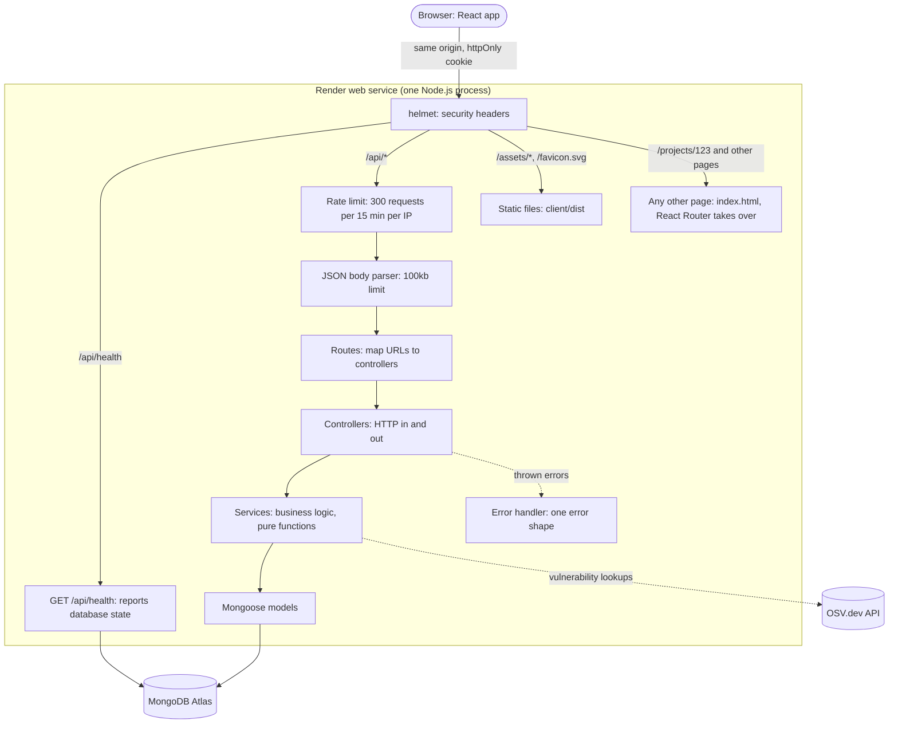

# Architecture

Firebreak is one Node.js process on Render. Express serves the JSON API under
`/api/*` and the built React app for every other path, so the browser only ever
talks to one origin.

## Request flow



- **Why one origin:** the login cookie is first-party, so `SameSite=Lax` works, no
  CORS setup is needed, and browsers that block third-party cookies cannot break login.
- **Development:** Vite serves the React app on port 5173 and forwards `/api` to the
  API on port 4000, so the browser still sees a single origin.
- **Errors:** every API error has the shape `{ "error": { "code": "...", "message": "..." } }`.
  Unexpected errors become a generic 500; their stack trace goes to the server log only.

## Folder structure

Some folders appear as the milestones that need them land.

```
client/                 React app (Vite)
  src/pages/            one component per page
  src/components/       shared UI (layout, buttons, status badges)
  src/hooks/            reusable React hooks
  src/api/              fetch wrapper, one module per resource
  src/lib/              browser-only logic (the .env name extractor)
server/
  src/index.js          validate env, connect to MongoDB, start listening
  src/app.js            Express app: middleware order, API, static client
  src/config/           env validation (zod), database connection
  src/routes/           URL -> controller mapping only
  src/controllers/      HTTP concerns: read the request, call services, send the response
  src/services/         business logic as pure functions, unit tested
  src/models/           Mongoose schemas
  src/middlewares/      auth, ownership checks, validation, rate limits, errors
  src/validators/       zod schemas for each request
  src/rules/            data tables: secret classification rules, frontend prefixes
  tests/                node --test unit and HTTP tests
scripts/dev.js          runs API and client together in development
render.yaml             Render deployment settings
```

## Startup

1. `server/src/config/env.js` validates environment variables with zod. If any are
   missing or invalid, the process prints which ones (never their values) and exits.
2. `server/src/index.js` connects to MongoDB, giving up after 10 seconds with a
   readable error instead of hanging.
3. The app starts listening. On `SIGTERM` (sent by Render before replacing an
   instance) it finishes in-flight requests, closes the database connection and exits.
